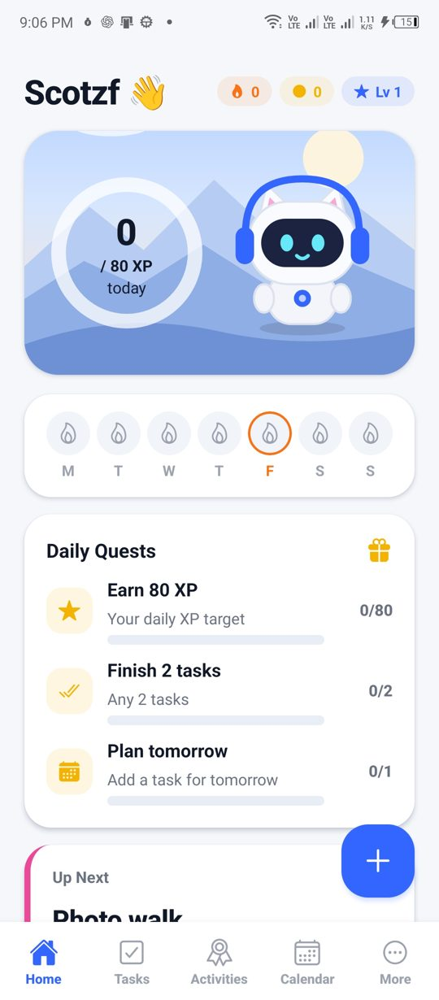
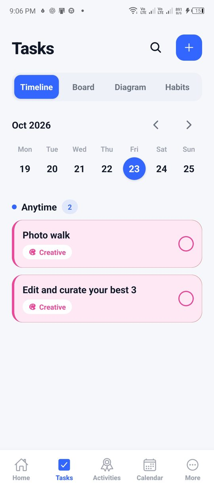
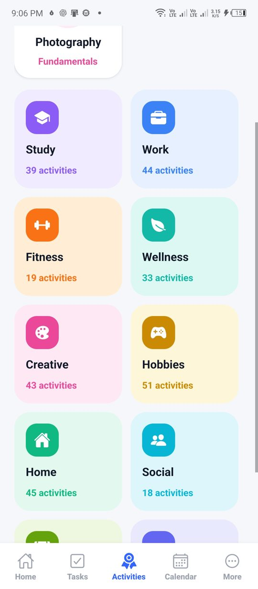
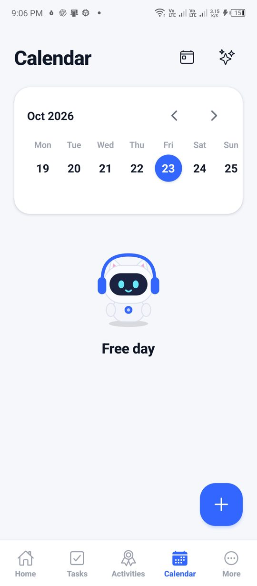
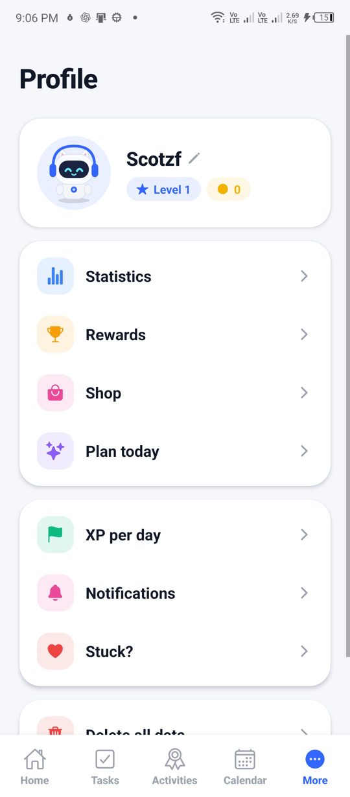

<p align="center">
  
</p>

<h1 align="center">Questly</h1>

<p align="center"><b>Duolingo for getting things done.</b><br/>
Finish real tasks, earn XP, keep your streak, and level up 332 real-life activities.</p>

<p align="center">
  
  
  
  
  
</p>

Questly is an Android app built with React Native, Expo SDK 58, TypeScript and Expo Router. It works offline and needs no account. Your mascot, **Pal**, cheers you on.

## Features

### The XP loop
- **XP for real work.** A task is worth 10 XP. High priority adds 10 and Medium adds 5. Finishing before the deadline adds 5. Each subtask is 3 XP.
- **Habit check-ins** are 5 XP each.
- **Activity milestones** are worth 25 XP each, and completing a level adds 50 XP.
- **Daily goal:** Casual 10, Regular 30, Serious 50 or Intense 80 XP per day, shown as a ring on Home.
- **Streak:** 🔥 counts each day you complete something. **Streak Freezes** cover a missed day automatically.
- **Daily quests:** 3 per day, chosen once and only when you can actually do them. Examples are *Earn 30 XP*, *Move your body*, *Clear today's list* and *Keep 2 habits*.
- **Levels, coins and achievements.** Coins are spent in the **Shop** on Streak Freezes and Pal outfits (glasses, scarf, party hat, wizard hat, crown).
- **Fair play.** A task ticked within 2 minutes of being added earns only 2 XP. Self-reported milestone XP is capped per day until evidence is attached.

### Activities (332)
Every activity from the Questly taxonomy is grouped as **10 areas → 35 categories → 332 activities**.
- **Study, Work, Fitness, Wellness and Creative**
- **Hobbies, Home, Social, Money and Growth**

Each activity has:
- **Levels** with a goal, typical weeks, measurable **milestones** (each with a verification type) and **practices**.
- Practices you can add as a **task** or a **habit** in one tap. **Start** adds the first level's practices to your tasks, and finishing a level queues the next one.
- Tips, common mistakes and resources. **Safety notes** cover fitness, health, money, tools, travel and similar activities.
- **Branching paths** where skills specialise. Photography branches into Portrait, Sports or Landscape, and Strength Training into Powerlifting, Bodybuilding or Olympic Lifting.

### Tasks and habits
- **Views:** Timeline (week strip), Board (To Do, In Progress, Done), Diagram (a subtask tree) and Habits.
- **Quick add** sheet. The area is auto-detected from the title, so "leg day at the gym" becomes Fitness. Swipe a task right to complete it and left to delete it.
- **Screenshot → task.** On-device text recognition (Google ML Kit) reads a screenshot or photo and fills in the title, due date, area and subtasks. It's free and works offline. You can also **Share → Questly** from any app.
- **Calendar**, a day planner for time blocks, reminders with quiet hours, and a daily summary.

### Also included
- **Statistics:** weekly XP, change versus last week, streaks and an area breakdown, with a **share card** for social media.
- **Home-screen widget:** streak, coins, level, today's XP and your next task.

## Tech

| | |
|---|---|
| App | React Native 0.88, Expo SDK 58, Expo Router, TypeScript |
| Storage | SQLite on the device. Older saved data is migrated on load. |
| Native modules (local) | `modules/text-scan` (ML Kit OCR and the share receiver), `modules/questly-widget` (the home-screen widget) |
| Content | `src/skills/`: taxonomy, the 332 activities, and a compact level builder |
| Logic | `src/domain.ts`: XP, quests, streaks, freezes, habits, skills and the planner, all as pure functions |

## Develop

```sh
npm ci
npm run typecheck
npx expo lint
npm test          # domain, scanner, activity-library format, upgrade survival
```

The test suite includes a **format checker** for all 332 activities (IDs, areas, levels, milestones, practices, title lengths and safety notes). It also has **upgrade-survival tests** that load data saved by earlier versions and check that tasks, habits, streaks and XP survive.

## Build an APK (Windows)

```powershell
./scripts/Build-Phone.ps1     # builds, copies Questly-<version>.apk to the Desktop,
                              # installs it if a phone is connected
./scripts/Mirror-Phone.ps1    # mirror the phone screen (scrcpy)
```

Native builds fail on long Windows paths. The script works around this by building from a short copy at `C:\fp`, using Android SDK CMake 3.31.6 (`cmake;3.31.6`), whose ninja supports long paths.

## Logo

`assets/questly-logo.svg` is the source. The adaptive icon (foreground, background and monochrome), the launcher icon and `assets/store/play-store-icon-512.png` are rendered from it.

## Roadmap
- Weekly **leagues** (global leaderboard, using Supabase)
- Recurring tasks and dark mode
- Google Play release: signing key, store listing and privacy policy
